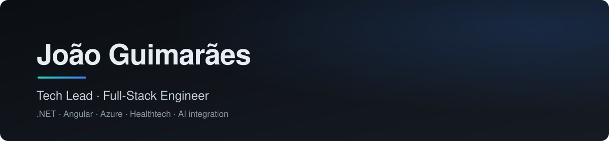

## Hi, I'm João 👋

**Tech Lead · Full-Stack Engineer · Healthtech**

I lead the engineering team at **VertiCare Systems**, building a clinical automation platform used in Portuguese hospitals and integrated with their systems via HL7. I own the platform architecture, the release process and production stability.

- 🤖 Leading the team building an **AI clinical assistant** — clinicians consult the patient's record, support consultations and generate medical reports, with real-time speech-to-text.
- 📐 Introduced **AI-assisted, spec-driven development** in the team: every feature starts from a written specification that drives implementation and review.
- 🏥 Four years in healthcare software — HL7 interoperability, CDA and GDPR in production.
- ☁️ Hybrid cloud / on-prem architecture on Azure (Azure Relay), with observability across both.

## 🛠️ Tech stack

**Languages & frameworks**

**Data, cloud & tools**

- **Backend:** .NET / C#, EF Core, REST APIs, SignalR, RabbitMQ, Clean Architecture
- **Frontend:** Angular, TypeScript, Nx, PrimeNG, Flutter
- **Data:** PostgreSQL, Redis
- **Cloud & DevOps:** Azure, Azure DevOps, CI/CD, Docker, observability, hybrid cloud / on-prem (Azure Relay)
- **Security & Identity:** Keycloak (OAuth 2.0 / OpenID Connect), Azure Key Vault, Managed Identity
- **AI Integration:** LLM integration, Python (FastAPI, LangChain), speech-to-text, AI-assisted & spec-driven development

## 📊 GitHub stats

  
  

## 🤝 Connect

&nbsp;

